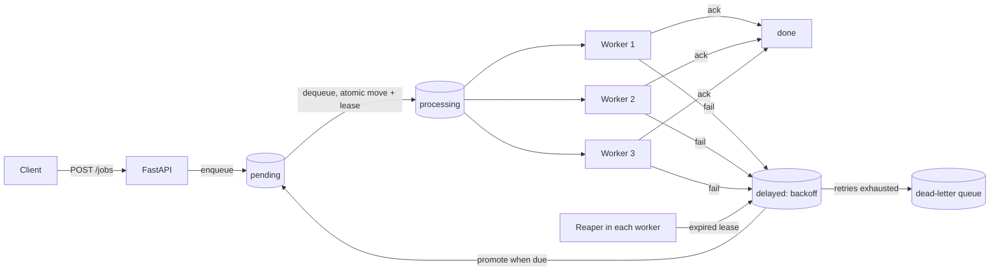

# Job Queue

A distributed background job queue built with **Python, FastAPI and Redis**. Jobs survive worker crashes, failed jobs retry with exponential backoff, and jobs that keep failing land in a dead-letter queue instead of disappearing.

## Features

- **At-least-once delivery.** A job is moved atomically from `pending` to `processing`, so it is never in limbo.
- **Lease-based crash recovery.** Every job taken by a worker gets a lease. If the worker dies, a reaper reclaims the job when the lease expires.
- **Late-ack protection.** If a worker finishes after its job was already reclaimed, its ack is rejected so the job is not completed twice.
- **Retries with exponential backoff.** Delays double on each attempt (2s, 4s, 8s, ...), tracked in a Redis sorted set.
- **Dead-letter queue.** After `max_retries`, a job moves to the DLQ. It can be inspected and re-queued through the API.
- **Idempotent enqueueing.** Submitting the same `idempotency_key` twice returns the original job instead of creating a duplicate.
- **Idempotent side effects.** Handlers can use `apply_effect` so a job that runs twice still changes state only once.
- **Race-safe state changes.** When two handlers race to fail the same job, exactly one wins (covered by a concurrency test).

## Architecture



All state lives in Redis. Workers are stateless, so you scale by running more of them.

## Quick start

Requires Docker.

```bash
docker compose up -d --build --scale worker=3
```

The API is now at `http://localhost:8000` (interactive docs at `/docs`).

```powershell
# submit a job
Invoke-RestMethod -Method Post -Uri http://localhost:8000/jobs -ContentType "application/json" -Body '{"type":"sleep","payload":{"seconds":2}}'

# check queue sizes
Invoke-RestMethod http://localhost:8000/stats
```

### API

| Method | Endpoint | Description |
|---|---|---|
| POST | `/jobs` | Enqueue a job (`type`, `payload`, optional `idempotency_key`, `max_retries`) |
| GET | `/jobs/{id}` | Job status, attempts, last error |
| GET | `/stats` | Counts for pending, processing, delayed, dead |
| GET | `/dead` | Jobs in the dead-letter queue |
| POST | `/jobs/{id}/retry` | Send a dead job back to pending |

### Try the crash recovery yourself

```powershell
docker compose up -d --scale worker=3
Invoke-RestMethod -Method Post -Uri http://localhost:8000/jobs -ContentType "application/json" -Body '{"type":"crash"}'
docker compose logs -f worker
```

The `crash` job kills the worker that first picks it up. Watch the logs: after the lease expires, another worker prints `reclaimed 1 stuck job(s)` and the job completes on its retry.

## Benchmark

100 jobs of 1 second each, enqueued through the API, timed until the queue fully drained. No jobs were lost or dead-lettered.

| Workers | Total time | Throughput |
|---|---|---|
| 1 | 100.8s | 0.99 jobs/s |
| 3 | 34.3s | 2.92 jobs/s |

That is a **~2.9x speedup** with 3 worker processes. Jobs are simulated with `sleep`, so this measures the queue's coordination overhead and scaling, not real workload performance.

Reproduce it:

```bash
docker compose up -d --scale worker=1
python benchmark.py 100
docker compose up -d --scale worker=3
python benchmark.py 100
```

## Tests and CI

20 tests (pytest) run against a real Redis, using a separate database so they never touch real queue data:

- unit tests for every queue operation (enqueue, dequeue, ack, fail, backoff, DLQ, requeue)
- a simulated worker crash, tested by expiring a lease by hand rather than waiting
- a late-ack-after-reclaim test
- a two-thread race test: only one of two competing failures wins
- API tests for status codes, idempotency flags and DLQ retry

```bash
docker run -d -p 6379:6379 redis:7
pip install -r requirements-dev.txt
pytest -v
```

GitHub Actions runs the suite against a Redis service container on every push and pull request, and checks that the Docker image builds.

## Design decisions and trade-offs

- **At-least-once, not exactly-once.** A job can run twice (for example, a worker is slow but alive when its lease expires). Handlers must therefore be idempotent, which is why `idempotency_key` and `apply_effect` exist.
- **Leases instead of heartbeats.** Simpler to reason about; the cost is that a crashed worker's job waits for the lease to expire before it is reclaimed.
- **Reaper runs inside every worker.** No separate service to deploy. Redis operations are atomic, so concurrent reapers do not double-reclaim.
- **Single Redis instance.** It is a single point of failure. Production use would add Redis persistence and replication or Sentinel.

## Project layout

```
core.py        queue logic (enqueue, dequeue, ack, fail, reaper, DLQ)
api.py         FastAPI app
worker.py      worker loop and job handlers
benchmark.py   throughput benchmark
tests/         pytest suite
.github/       CI workflow
```